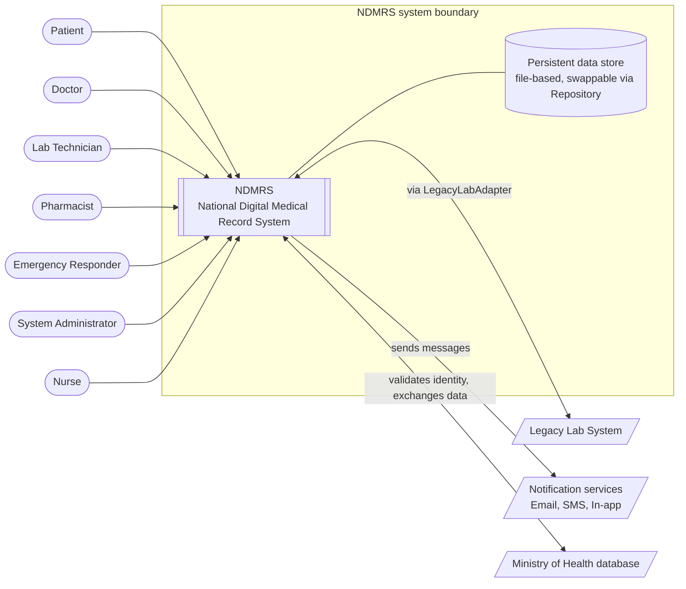

# National Digital Medical Record System (NDMRS)

**Team ArchiMed** · CSE4203: Principles of Software Architecture
**Instructor:** Dr. Nada Mahmoud Hassan · 
**TA:** Eng. Mohamed Fareh

| Member | Student ID |
|---|---|
| Tasneem Ahmed | 231014462 |
| Farha Ahmed | 231005085 |
| Mahmoud Samer | 231006522 |
| Malek Fayez | 231006679 |

## Milestones

| # | Deliverable | Due | Status | Section |
|---|---|---|---|---|
| M1 | Proposal & architectural requirements | Oct 23, 2026 | Submitted | [Milestone 1](#milestone-1--proposal--architectural-requirements) |
| M2 | Architecture document | TBD | Not started | [Milestone 2](#milestone-2--architecture-document) |
| M3 | Prototype | TBD | Not started | [Milestone 3](#milestone-3--prototype) |
| M4 | Evaluation and presentation | TBD | Not started | [Milestone 4](#milestone-4--evaluation-and-presentation) |


## Repository layout

```
.
├── README.md                  # this file: living project documentation
├── docs/
│   ├── m1/                    # Milestone 1 PDF + diagram sources
│   ├── m2/                    # Milestone 2 PDF + diagram sources
│   ├── m3/
│   └── m4/
└── src/                       # prototype code (Milestone 3)
```

---

# Milestone 1 — Proposal & Architectural Requirements

**Contents:**
[1. System Overview](#1-system-overview)

· [2. Stakeholders and Concerns](#2-stakeholders-and-concerns)

· [3. System Context (C4 Level 1)](#3-system-context-c4-level-1)

· [4. Functional Requirements](#4-functional-requirements) 

· [5. Quality Attribute Scenarios](#5-quality-attribute-scenarios)

· [6. Constraints](#6-constraints)

· [7. Architecturally Significant Requirements](#7-architecturally-significant-requirements-asrs)

· [Contribution Table](#contribution-table)

· [References](#references)

## 1. System Overview

**Problem.** Patient health data is typically scattered across clinics, hospitals, labs and pharmacies. A doctor treating a patient often cannot see past encounters, allergies, lab results or active prescriptions, which leads to repeated tests, prescribing errors and slow emergency care. Existing lab systems are legacy and cannot be replaced overnight.

**Solution.** NDMRS is a national digital medical record system. It keeps one chronological record per patient (demographics, blood type, allergies, chronic conditions, vaccinations, encounters, diagnoses, clinical notes, prescriptions and lab results) and exposes it to the right people through role-specific dashboards.

**Who uses it.** Five clinical and patient-facing roles, each with its own dashboard: Patient, Doctor, Lab Technician, Pharmacist and Emergency Responder. A System Administrator manages accounts and roles.

**Also.** Nurses support encounters and record observations. NDMRS integrates with an existing legacy laboratory system and with the Ministry of Health national database.

**Main capabilities.** Account and identity management; patient records with a chronological timeline; clinical encounters; prescriptions and dispensing; laboratory orders and results; emergency access to critical data; notifications; and a complete audit trail.

**Why it is architecturally interesting.**

- **Security vs. usability.** Medical data is highly sensitive and every access must be authorized and audited, yet in an emergency a responder needs fast access to a patient's allergies and blood type (break-glass access).
- **Modifiability vs. performance.** The design is a layered system (Bootstrap, Presentation, Application Services, Domain, Infrastructure) with 8 bounded modules (Identity, Patient Records, Clinical, Lab, Pharmacy, Emergency, Notification, Audit). Loose coupling through an in-memory domain-event bus makes the system easy to extend, but adds indirection that must not hurt response time.
- **Integration.** A legacy lab system must be wrapped (Adapter) and notifications must be deliverable over several channels (Strategy).
- **Rich design-pattern use.** The architecture applies 14 patterns, including the 5 required ones: Singleton (ApplicationContext), Abstract Factory (role dashboards), Factory Method (repositories), Iterator (patient timeline) and Observer (event bus).
- **Many roles over one record.** The eight bounded modules share one domain model, and each role works on it through its own dashboard.
- **Lifecycle workflows.** Encounters, prescriptions and lab orders move through states, and several parties must react to each change.

**Initial architectural direction.** The team's design work starts from a layered architecture with bounded modules (Bootstrap, Presentation, Application Services, Domain, Infrastructure); a Java Swing GUI using Model-View-Presenter; repository-based, swappable file persistence; and domain events published over an in-memory event bus. This is a starting hypothesis; the final choice will be justified against the quality attributes in Milestone 2.

## 2. Stakeholders and Concerns

| # | Stakeholder | Key concerns |
|---|---|---|
| 1 | Patients | Privacy of their data; easy read-only access to their own history, prescriptions and results; being notified of new results/prescriptions |
| 2 | Doctors | Complete and fast view of a patient's history; safe prescribing (allergy awareness); simple encounter workflow |
| 3 | Lab technicians | Easy upload of lab results; compatibility with the existing legacy lab equipment/system; accurate order tracking |
| 4 | Pharmacists | Verified prescriptions; preventing double dispensing; clear prescription state (pending, dispensed, expired, cancelled) |
| 5 | Emergency responders | Immediate access to critical data (blood type, allergies, conditions) under time pressure, with that access fully logged |
| 6 | System administrators / operators | Account and role management; deployment simplicity; monitoring; backup of the data store |
| 7 | Health ministry / regulators | Auditability of every access and change; compliance with health-data privacy rules; data integrity |
| 8 | Developers / maintainers (the team) | Modifiability, testability, clear module boundaries, ability to swap storage, notification and lab integrations |
| 9 | Healthcare facilities (hospitals, labs, pharmacies) | Interoperability with existing lab systems; reliability; minimal disruption to current workflows |
| 10 | Nurses | Simple screens; correct patient identification; limited but sufficient permissions |
| 11 | Ministry of Health (business owner) | National interoperability; cost; accountability and reporting |

## 3. System Context (C4 Level 1)

NDMRS is shown as a single system. Seven roles use it; it exchanges data with the legacy lab and the Ministry of Health database, and sends messages through the notification services. The persistent data store is infrastructure inside the system boundary (accessed only through repository interfaces so it can be swapped), so it is drawn inside the boundary rather than as an external system.

> Diagram source: add the original C4 file to `docs/m1/` (for example `c4-context.drawio`) and link it here.



**Users (people)**

| Actor | Interaction with NDMRS |
|---|---|
| Patient | Logs in, views own record, timeline, prescriptions, lab results; receives notifications |
| Doctor | Opens/closes encounters, writes diagnoses, notes and prescriptions, orders labs, searches patients |
| Lab Technician | Views lab orders and uploads lab results |
| Pharmacist | Views prescriptions and dispenses them |
| Emergency Responder | Requests emergency access to a patient's critical information |
| System Administrator | Creates and manages accounts, roles and permissions |
| Nurse | Supports encounters and records observations |

**External systems**

| External system | Relationship |
|---|---|
| Legacy Lab System | Provides/accepts lab results in a legacy format; NDMRS wraps it through the `LegacyLabAdapter` |
| Notification services (Email, SMS, In-app) | NDMRS sends messages to patients when results are ready, prescriptions are written or dispensed, etc. |
| Ministry of Health database | National registry used to validate identity and exchange patient and facility data |

## 4. Functional Requirements

Priorities use MoSCoW. The last column marks what the Milestone 3 prototype will implement. IDs are grouped by priority (Must, Should, Could, Won't).

| ID | User story | Priority | In M3 prototype |
|---|---|---|---|
| FR1 | As any user, I can log in with a role-based account so that I only see what my role allows. | Must | Yes |
| FR2 | As a doctor, I can open an encounter for a patient and close it when finished. | Must | Yes |
| FR3 | As a doctor, I can view a patient's full chronological timeline (encounters, diagnoses, notes, prescriptions, lab results). | Must | Yes |
| FR4 | As a doctor, I can write a prescription within an encounter. | Must | Yes |
| FR5 | As a pharmacist, I can dispense a valid prescription and the system prevents dispensing it twice. | Must | Yes |
| FR6 | As a lab technician, I can upload a lab result for a lab order. | Must | Yes |
| FR7 | As an emergency responder, I can get emergency access to a patient's critical data, and the access is recorded. | Must | Yes |
| FR8 | As an auditor/admin, I can see an audit log of who accessed or changed what. | Must | Yes |
| FR9 | As a clerk or doctor, I can register a new patient record. | Must | Yes |
| FR10 | As a patient, I can view my own record, prescriptions and lab results (read-only). | Should | Yes |
| FR11 | As a patient, I get a notification when a lab result or prescription is added. | Should | Yes (one channel) |
| FR12 | As a doctor, I can search for patients with combined criteria (e.g., age over 60 AND diabetic AND NOT allergic to penicillin). | Should | Yes |
| FR13 | As a doctor, I can order a lab test and track its state (ordered, in progress, completed, verified). | Should | Partially |
| FR14 | As an administrator, I can create, deactivate and assign roles to accounts. | Should | No |
| FR15 | As a lab technician, results from the legacy lab system are imported automatically. | Could | Yes (simulated legacy lab) |
| FR16 | As a patient, I can receive notifications by email or SMS in addition to in-app. | Could | No |
| FR17 | As a nurse, I can record observations and update the encounter state. | Could | No |
| FR18 | As the system, I can synchronize with the Ministry of Health database. | Could | No |
| FR19 | As a user, I can use the system in Arabic and English. | Won't (this release) | No |

<details>
<summary>ID changes from the submitted PDF</summary>

The submitted PDF listed FR17–FR19 after FR16, out of priority order. IDs were renumbered so they run in priority order. Mapping (old → new): FR17 → FR9, FR9 → FR10, FR10 → FR11, FR11 → FR12, FR12 → FR13, FR13 → FR14, FR14 → FR15, FR15 → FR16, FR18 → FR17, FR19 → FR18, FR16 → FR19. FR1–FR8 are unchanged. All cross-references in this README use the new IDs.

</details>

## 5. Quality Attribute Scenarios

Ten scenarios covering security, usability, performance, modifiability, availability, interoperability and testability.

### QAS-1 — Security (access control)

| Part | Description |
|---|---|
| Source | A logged-in pharmacist (or an attacker with a valid pharmacist account) |
| Stimulus | Attempts to read a patient's clinical notes or write a prescription |
| Artifact | Application services layer (command handlers) |
| Environment | Normal operation |
| Response | The request is rejected by the authorization decorator before reaching the domain; the attempt is written to the audit log |
| Response measure | 100% of unauthorized requests are rejected in a test suite of at least 50 role/permission combinations; each rejection is logged within 1 second |

### QAS-2 — Security / Usability trade-off (emergency access)

| Part | Description |
|---|---|
| Source | Emergency responder |
| Stimulus | Requests emergency access to an unconscious patient's record |
| Artifact | Emergency module and authorization policy |
| Environment | Emergency, normal load |
| Response | The system grants read-only access to critical data only (blood type, allergies, chronic conditions), publishes an `EmergencyAccessGranted` event, and notifies the patient |
| Response measure | Access is granted in at most 3 user actions and under 2 seconds; 100% of such accesses appear in the audit log with responder ID and timestamp |

### QAS-3 — Performance

| Part | Description |
|---|---|
| Source | Doctor |
| Stimulus | Opens a patient's timeline (merged chronological view of encounters, prescriptions and lab results) |
| Artifact | `PatientTimeline` iterator, repositories and presentation layer |
| Environment | Normal operation, 50 concurrent users, patient with 500 historical events |
| Response | The timeline is displayed |
| Response measure | 95% of requests complete in under 1 second; the first page of events appears in under 500 ms |

### QAS-4 — Modifiability

| Part | Description |
|---|---|
| Source | Developer |
| Stimulus | Needs to add a new notification channel (e.g., WhatsApp) or replace the file-based storage with a database |
| Artifact | Notification module (Strategy) and persistence layer (Repository, Factory Method) |
| Environment | Design time / maintenance |
| Response | The change is made by adding a new class that implements the existing interface and changing configuration only; no domain or presentation code changes |
| Response measure | Completed by one developer in at most 2 person-days; at most 2 existing source files modified; all existing tests still pass |

### QAS-5 — Availability / Reliability

| Part | Description |
|---|---|
| Source | Legacy lab system |
| Stimulus | Becomes unreachable or returns malformed data while a technician uploads or imports a result |
| Artifact | `LegacyLabAdapter` and lab integration module |
| Environment | Normal operation |
| Response | The adapter fails safely: the error is reported to the technician, the result is queued for retry, and the rest of the system (records, prescriptions) continues working |
| Response measure | No effect on other use cases (0 failed requests elsewhere); failed imports are retried automatically for up to 3 attempts; the system remains 99% available during a 1-hour simulated lab outage |

### QAS-6 — Testability / Auditability

| Part | Description |
|---|---|
| Source | Tester or regulator |
| Stimulus | Needs to verify that every important change was recorded |
| Artifact | Event bus, audit module and command handlers |
| Environment | Test environment with in-memory repositories |
| Response | Each command (write prescription, dispense, upload result, close encounter, grant emergency access) publishes a domain event that the audit handler records |
| Response measure | 100% of the 5 domain-event types produce an audit entry; domain logic can be unit-tested without the GUI, with at least 70% line coverage on the domain and application layers |

### QAS-7 — Modifiability (new user role)

| Part | Description |
|---|---|
| Source | Developer |
| Stimulus | Adds a new user role (for example Radiologist) with its own dashboard |
| Artifact | Presentation layer and dashboard factory |
| Environment | Design time |
| Response | The new role is added without changing existing role code |
| Response measure | At most 3 existing files modified; completed in under 1 working day; all existing tests still pass |

### QAS-8 — Availability (notification gateway outage)

| Part | Description |
|---|---|
| Source | Notification gateway |
| Stimulus | Becomes unreachable while a doctor writes a prescription |
| Artifact | Notification module and event bus |
| Environment | Normal operation, gateway down |
| Response | The prescription is saved; the notification is queued and retried |
| Response measure | 100% of prescriptions are saved during a 30-minute gateway outage; queued alerts are delivered within 5 minutes after recovery |

### QAS-9 — Interoperability (legacy lab results)

| Part | Description |
|---|---|
| Source | Legacy lab system |
| Stimulus | Returns results in its own format |
| Artifact | Lab integration adapter |
| Environment | Normal operation |
| Response | Results are converted to the domain result model and attached to the correct order |
| Response measure | 99% of 100 sample results are mapped correctly; replacing the adapter requires no change in the Domain layer |

### QAS-10 — Security (auditability of every access)

| Part | Description |
|---|---|
| Source | Any authenticated user |
| Stimulus | Reads or modifies a patient record |
| Artifact | Audit module and record access path |
| Environment | Normal operation |
| Response | An audit entry is written with user, role, patient, action and timestamp |
| Response measure | 100% of 1,000 scripted accesses have a matching audit entry; entries cannot be edited through the application |

## 6. Constraints

**Technical**

- Implemented in Java; the GUI uses Java Swing with the Model–View–Presenter pattern.
- Persistence is file-based in the prototype, but must be accessed only through repository interfaces so it can be swapped.
- Components communicate through an in-memory event bus (Observer); no external message broker in the prototype.
- The legacy lab system cannot be modified; it must be wrapped by an adapter.
- The architecture must use the five required patterns (Singleton, Abstract Factory, Factory Method, Iterator, Observer).
- Passwords must be stored only as hashes, using a replaceable hashing strategy.
- The prototype must run on a standard student laptop with no paid cloud services.

**Business / regulatory**

- Patient data is confidential; every access and change must be auditable.
- No real patient data is used; only synthetic data in the prototype.
- Only free and open-source libraries and tools may be used.

**Organizational**

- Team of 4 students.
- Milestones: M1 due October 23, 2026, then M2 (architecture document), M3 (prototype), M4 (evaluation and presentation).
- All work is submitted through GitHub as PDFs named `TeamName_Project'sTitle.pdf`, with diagram source files in the repository.
- Late submissions lose 10% per day, up to 3 days.

## 7. Architecturally Significant Requirements (ASRs)

Business value and architectural impact are rated High / Medium / Low. Each ASR row is rated by its lead scenario. Related scenarios (marked ↳) are grouped under the same row and keep their own ratings in the utility tree below, so every one of the ten scenarios is traceable to an ASR.

| Rank | Requirement | Business value | Architectural impact | Source |
|---|---|---|---|---|
| 1 | Role-based authorization and audit of all access (QAS-1, FR1, FR8) <br>↳ complete audit trail (QAS-10) | H | H | Security |
| 2 | Emergency break-glass access with logging (QAS-2, FR7) | H | H | Security vs. usability |
| 3 | Swappable storage, notification and lab integrations (QAS-4, FR15, FR16) <br>↳ add new roles without touching existing role code (QAS-7) | M | H | Modifiability |
| 4 | Timeline performance for large records (QAS-3, FR3) | H | M | Performance |
| 5 | Fault isolation from the legacy lab system (QAS-5, FR15) <br>↳ notification gateway outage must not block prescriptions (QAS-8, FR11) <br>↳ legacy result interoperability (QAS-9) | M | H | Availability |
| 6 | Testability without the GUI (QAS-6) | M | M | Testability |
| 7 | Patient notifications (FR11) | M | L | Functional |
| 8 | Bilingual UI (FR19) | L | L | Usability |

### Justification of the top 5

1. **Authorization and audit (security).** This affects every command and every query, so it must be built into the structure and not added later. It drives the layered style and the Decorator pattern: Authorization, Audit and Logging decorators wrap every command handler, so the Domain layer stays free of security code.
2. **Emergency access (security vs. usability).** This is the main competing-quality-attribute pair of the project. It requires a dedicated Emergency module, a restricted read-only view and mandatory audit, and it shapes the Identity and Access design (roles and permissions).
3. **Modifiability.** Storage, notification channels, roles and the lab system are all expected to change. This drives the use of bounded modules, the Repository pattern with Factory Method, Strategy for notifications and hashing, the Abstract Factory for role dashboards, and the Adapter for the legacy lab. The Observer-based domain-event bus lets new reactions (audit, notifications) be added without changing the publisher.
4. **Performance of the timeline.** Merging encounters, prescriptions and lab results chronologically must stay fast as records grow. This drives the Iterator-based Patient Timeline and the need for efficient repository queries (Specification pattern for filtered searches).
5. **Availability through fault isolation.** A failing legacy lab or notification gateway must not stop clinical work. This drives putting the lab behind an Adapter and a gateway interface, and handling failures and retries at the module boundary.

### Utility tree (summary)

| Quality attribute | Refinement | Scenario | (Value, Impact) |
|---|---|---|---|
| Security | Access control | QAS-1 | (H, H) |
| Security | Emergency access | QAS-2 | (H, H) |
| Security | Complete audit trail | QAS-10 | (H, H) |
| Modifiability | Add roles easily | QAS-7 | (H, H) |
| Modifiability | Change integrations | QAS-4 | (M, H) |
| Performance | Timeline response | QAS-3 | (H, M) |
| Availability | Isolate notification gateway | QAS-8 | (H, M) |
| Availability | Legacy lab failure | QAS-5 | (M, H) |
| Interoperability | Wrap legacy lab system | QAS-9 | (M, H) |
| Testability | Domain tests without GUI | QAS-6 | (M, M) |

### Key trade-offs to resolve in Milestone 2

1. **Security vs. usability.** Emergency access must be fast but still controlled and audited.
2. **Modifiability vs. performance.** Event-based decoupling adds indirection that must still meet the QAS-3 response time.
3. **Availability vs. consistency.** Queued notifications are delivered eventually, so alerts may lag behind saved data.

## Contribution Table

| Member | Contribution |
|---|---|
| Tasneem Ahmed | Sections 1–2 |
| Farha Ahmed | Section 3 and context diagram |
| Mahmoud Samer | Sections 4 and 6 |
| Malek Fayez | Sections 5 and 7, references |

## References

1. L. Bass, P. Clements, and R. Kazman, *Software Architecture in Practice*, 4th ed. Addison-Wesley, 2021.
2. E. Gamma, R. Helm, R. Johnson, and J. Vlissides, *Design Patterns: Elements of Reusable Object-Oriented Software*. Addison-Wesley, 1994.
3. S. Brown, *The C4 Model for Visualising Software Architecture*. [Online]. Available: https://c4model.com
4. M. Fowler, *Patterns of Enterprise Application Architecture*. Addison-Wesley, 2002.
5. NDMRS Component Architecture (Visualized), team document, 2026.

---

# Milestone 2 — Architecture Document

**Status:** Not started · **PDF:** `docs/m2/` · **Due:** TBD

Planned content (edit as the assignment brief is confirmed):

- Architecture views (C4 Level 2 containers, Level 3 components) with diagram sources
- Justification of the architectural style against the QAS and ASRs from Milestone 1
- Design pattern catalogue (the 14 patterns, with where and why each is used)
- Resolution of the three trade-offs listed at the end of Milestone 1
- Traceability table: ASR → decision → pattern → component

# Milestone 3 — Prototype

**Status:** Not started · **Code:** `src/` · **Due:** TBD

Scope is fixed by the "In M3 prototype" column in [Functional Requirements](#4-functional-requirements). Add build/run instructions, test coverage results (target ≥ 70% on domain and application layers) and a demo walkthrough here.

# Milestone 4 — Evaluation and Presentation

**Status:** Not started · **Slides:** `docs/m4/` · **Due:** TBD

Add the evaluation of the prototype against each QAS response measure (measured values vs. targets), lessons learned and the final presentation here.

---

<!--
HOW TO EXTEND THIS README
1. Fill in the milestone's section above and set its Status in the Milestones table at the top.
2. Put the submitted PDF and diagram sources in docs/mN/ and link them from the section.
3. Keep requirement IDs (FRn, QAS-n) stable from now on; later milestones should reference them.
-->
